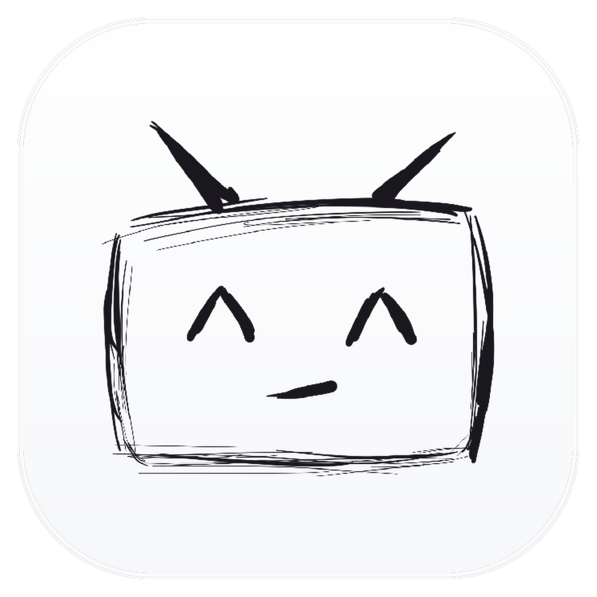
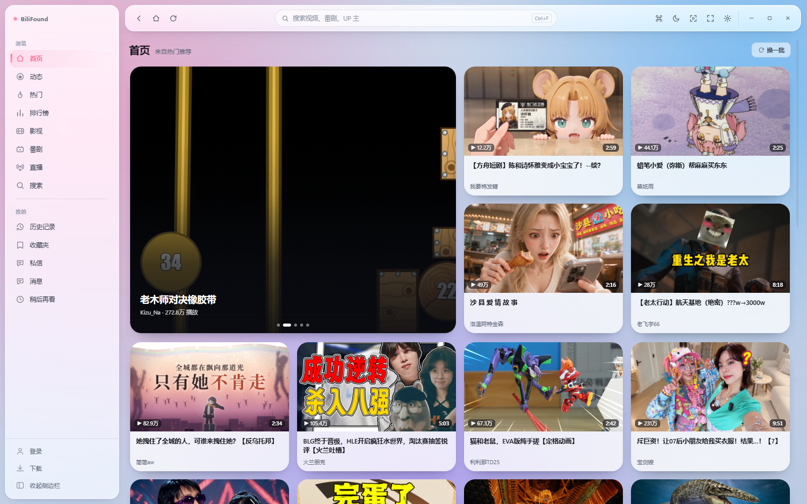
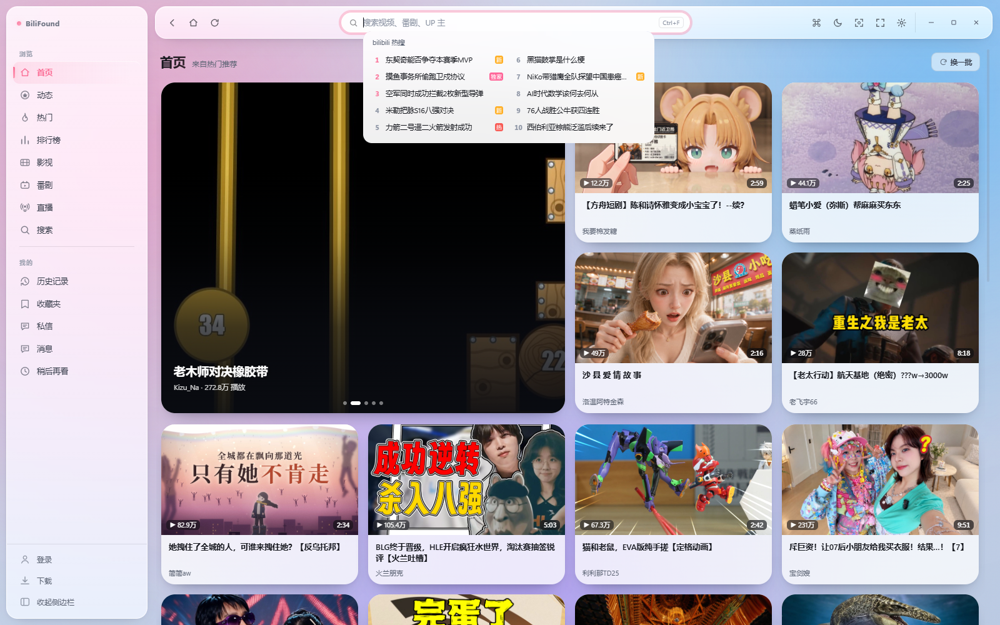
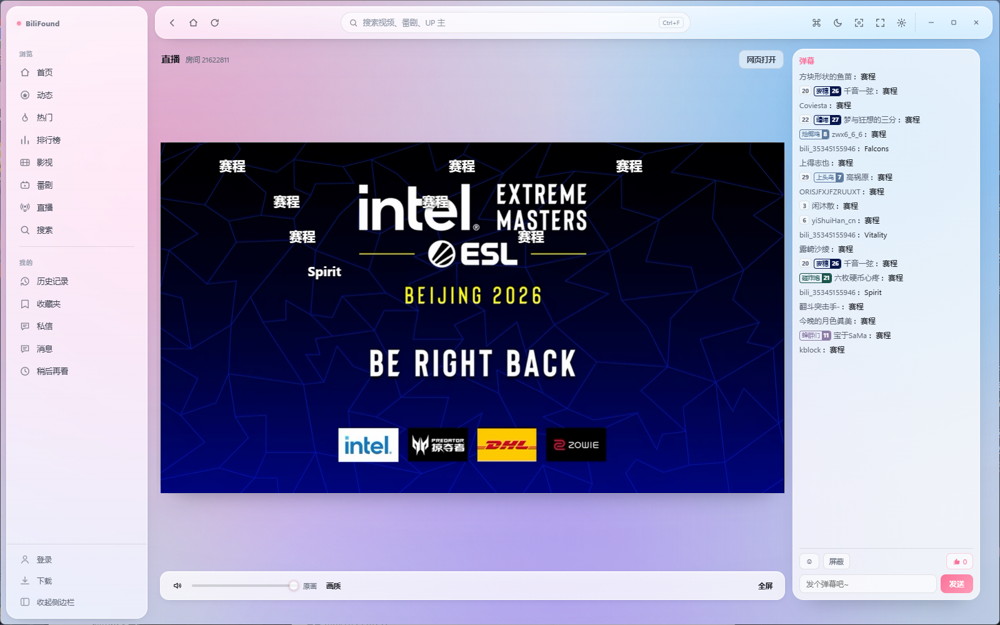
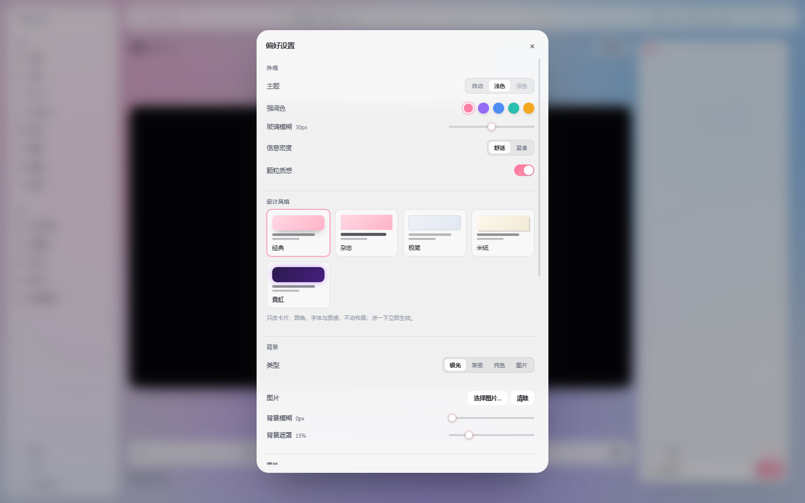

<div align="center">



# BiliFound

**原生液态玻璃风格的哔哩哔哩桌面客户端 · Windows / macOS**

自绘界面 · 自建播放器 · 原生直播与番剧 · 无网页套壳


</div>

---

## 这是什么

一个**完全自绘界面**的 B 站桌面客户端：内容来自哔哩哔哩公开接口，界面、播放器、弹幕层全部由本项目自己绘制，
不是「网页套个壳」。播放走自建播放器（DASH 视频/音频双流），直播走 hls.js + WebSocket 弹幕，
整体是液态玻璃 + 极光背景的视觉风格。

> **同一套业务层与视觉系统，同时提供 Windows（x64）与 macOS（Apple Silicon / M 系列）两个版本**，
> 差异只集中在窗口、菜单与打包环节。仅用于学习与个人使用，与哔哩哔哩官方无关，
> 详见[免责声明](#免责声明)。

## 截图

<table>
<tr>
<td width="50%"><br /><sub><b>首页</b> · 顶部大轮播 + 侧卡 + 自适应网格</sub></td>
<td width="50%"><br /><sub><b>搜索</b> · 历史 + 热搜 + 联想词高亮</sub></td>
</tr>
<tr>
<td width="50%"><br /><sub><b>直播</b> · 左播放器 + 右侧弹幕栏（等级 / 粉丝牌 / 舰队）</sub></td>
<td width="50%"><br /><sub><b>设计风格</b> · 经典 / 杂志 / 极简 / 米纸 / 霓虹</sub></td>
</tr>
</table>

## 功能

| 模块 | 说明 |
| --- | --- |
| **首页** | 顶部大轮播（5 张自动切换）+ 侧卡 + 统一网格；列数随窗口自适应（小窗 4 列、全屏 5 列）；右上角「换一批」重新拉推荐 |
| **视频页** | 自建播放器：DASH 双流、清晰度切换、弹幕浮层、CC 字幕、倍速、截图、画中画、播放器全屏；分 P 选集、相关推荐、评论/弹幕双 Tab、一键三连、投币、收藏、下载、进度记忆（5 秒一存，自动续播） |
| **直播** | 左播放器 + 右侧弹幕栏；弹幕带用户等级、粉丝牌、舰队徽章；点赞、表情、按关键词/等级屏蔽；多 CDN 探测取流、画质切换、全屏 |
| **关注直播** | 动态页左栏显示关注中正在直播的主播（真实总数），「全部 ›」进入完整列表页，无限翻页 |
| **搜索** | 点开即「搜索历史 + bilibili 热搜」，输入即联想、命中词标红，↑↓ 选择 / Enter 搜索 |
| **动态** | 全类型卡片（图文/转发/视频/番剧/专栏/直播/音乐/合集）、按 UP 筛选、动态详情 + 评论、发布/转发/删除 |
| **其它** | 热门 / 排行榜 / 番剧影视 / 评论（含表情与配图）/ 私信 / 专栏 / UP 主页 / 收藏 / 历史 / 稍后再看 / 关注粉丝 / 消息中心 |
| **外观** | 液态玻璃 + 极光背景；浅色/深色/跟随系统、强调色、模糊强度、信息密度、颗粒、自定义背景；5 种设计风格预设；侧边栏折叠、沉浸模式、命令面板 |

## 下载

前往 [**Releases**](https://github.com/NstyZ/BiliFound/releases) 下载，两个平台各取所需：

### Windows（x64）

| 文件 | 适合 |
| --- | --- |
| `BiliFound-1.0.0-Setup-x64.exe` | **长期使用**：安装版，自动建桌面/开始菜单快捷方式，带卸载程序 |
| `BiliFound-1.0.0-Portable-x64.exe` | **发给别人 / U 盘**：单文件双击即用，不写注册表、不留快捷方式 |
| `BiliFound-1.0.0-win32-x64.zip` | **绿色目录**：解压即用，想直接看程序文件时用 |

### macOS（Apple Silicon / M 系列）

| 文件 | 适合 |
| --- | --- |
| `BiliFound-1.0.0-arm64.zip` | **免安装**：解压后把 `BiliFound.app` 拖进「应用程序」或任意目录 |

> macOS 版为 **arm64 原生构建**，Apple Silicon（M 系列）机型可直接运行；不支持 Intel Mac。
> 未签名、未公证，首次打开请**右键 →「打开」**；若仍被拦下，在终端执行：
> `xattr -dr com.apple.quarantine /Applications/BiliFound.app`

macOS 版补充说明：

| 项目 | 说明 |
| --- | --- |
| 系统要求 | macOS 13 Ventura 及以上 |
| 应用标识 | `com.styzn.bilifound` |
| 数据目录 | `~/Library/Application Support/BiliFound`（设置、背景、登录态） |
| 登录 | 侧边栏底部「登录」，应用内弹出 B 站官方登录页 |
| 窗口全屏 | `⌃⌘F` 或工具栏全屏按钮（与播放器内的「视频全屏」是两个入口） |
| 退出全屏 | `Esc`（直播全屏另有画面右上角「退出全屏」按钮） |

> Windows 安装包同样未做代码签名，首次运行如提示「Windows 已保护你的电脑」→
> 点「更多信息 → 仍要运行」。各产物的 SHA256 见
> [SHA256SUMS.txt](SHA256SUMS.txt) 与 [WINDOWS版说明.md](WINDOWS版说明.md)。

## 从源码运行

两个平台共用同一份源码：`renderer/` 与业务逻辑完全一致，平台差异在窗口、菜单与打包脚本里。
需要 Node.js 22+、（打包时）Python 3 + Pillow。

```bash
git clone https://github.com/NstyZ/BiliFound.git
cd BiliFound
npm install
npm start          # = electron .
npm run probe      # 冒烟测试：结果写在 build/probe/report.json
```

> Windows 上如果 Electron 把主进程当成 Node 跑（报 `require is not defined`），
> 先清掉环境变量：`$env:ELECTRON_RUN_AS_NODE = $null`。
>
> macOS 上如果继承了 `ELECTRON_RUN_AS_NODE`，用 `env -u ELECTRON_RUN_AS_NODE npm start` 启动。
>
> `npm run probe` 运行的是 `tools/probe-main.js`，其中「窗口按钮」「platform-win 类名」等
> 3 项是 Windows 专用断言，在 macOS 上按设计不通过，其余检查应全绿。

## 打包

```powershell
npm run icon      # 生成 build\icon.ico / icon.png 与 assets\ 副本（需要 Python + Pillow）
npm run dist      # 绿色包 → dist\BiliFound-win32-x64\ + zip
npm run setup     # 安装版 + 便携版 → dist-installer\
npm run release   # 上面两样一起做
```

- 绿色包可复用本地 Electron：`$env:BILIFOUND_ELECTRON_ZIP_DIR = "<解压好的 electron 目录>"`
- 安装版/便携版复用 `node_modules\electron\dist`（见 `electron-builder.yml` 的 `electronDist`）；
  NSIS 与 winCodeSign 首次会从 GitHub 下载到 `$env:ELECTRON_BUILDER_CACHE`（建议放在工程目录外）。

### macOS（arm64）

macOS 侧**不使用 electron-builder**（仓库里的 `electron-builder.yml` 与 `tools/build-win.js` 只负责 Windows）。
macOS 用 `electron-packager` 直接产出 `.app`，再压缩成 zip：

```bash
# 1) 生成 .icns（仓库只带 1024 PNG；需要 macOS 自带的 sips / iconutil）
bash tools/make-icns.sh build/icon-1024.png

# 2) 打包 .app
npx electron-packager . BiliFound \
  --platform=darwin --arch=arm64 \
  --icon=build/icon.icns \
  --app-bundle-id=com.styzn.bilifound \
  --app-version=1.0.0 \
  --overwrite \
  --ignore="^/build" --ignore="^/tools" \
  --ignore="/node_modules/electron/dist"

# 3) 压缩为发布资产
ditto -c -k --sequesterRsrc --keepParent \
  BiliFound-darwin-arm64/BiliFound.app \
  BiliFound-1.0.0-arm64.zip
```

> macOS 产物不做代码签名与公证；分发给他人时对方需右键打开或放行 Gatekeeper。
> 发布资产命名建议保持 `BiliFound-<版本>-arm64.zip`，应用内更新按 `arm64`/`mac` 关键字挑选。

## 目录结构

> 仓库同时包含 Windows 与 macOS 两个版本：`renderer/`、`main.js` 与业务层两端共用，
> 平台差异集中在 `main.js` 的 `isMac / isWin` 分支、窗口菜单与打包脚本。

```
renderer/            自绘界面（原生 DOM，无网页）—— 两端共用
├── index.html       侧边栏 + 工具栏 + 内容视图 + 设置浮层
├── style.css        液态玻璃主题（含 5 套设计风格预设）
├── app.js           路由、接口调用、首页/搜索/视频/直播/番剧等全部渲染逻辑
├── player.html      自建播放器：DASH 双流、弹幕层、字幕、全屏控制
└── live.html        直播页：hls.js + 画面弹幕层
main.js              窗口、接口代理、WebContentsView、登录窗、更新（含平台分支）
preload.js           contextBridge 暴露 api / player / settings / 窗口状态等能力
player-preload.js    播放器与外壳的消息通道（含滚轮转发）
live-preload.js      直播视图桥（退出全屏）
tools/               图标生成、打包、冒烟测试、截屏（不打包）
docs/                技术文档、移植报告、同步清单、截图
assets/              随包分发的图标（Windows）

# Windows 专用
electron-builder.yml 安装版 / 便携版打包配置
tools/build-win.js   绿色包与 zip 构建脚本
inject/              Windows 侧使用的注入资源
WINDOWS版说明.md     Windows 版使用说明

# macOS 专用
build/icon-1024.png  1024 图标源文件（用 tools/make-icns.sh 生成 .icns）
tools/make-icns.sh   sips + iconutil 生成 .icns
```

## 技术要点

- **不走 iframe**：播放器是 `WebContentsView` 原生视图，叠在播放器槽位上，尺寸随布局实时同步（`ResizeObserver`）。
- **接口代理**：主进程用 `session.fromPartition('persist:bili').fetch` 请求，自动携带登录 Cookie；
  渲染层通过 `bg.api(path)` 拿 JSON，天然没有 CORS；WBI 签名也在主进程完成。
- **登录**：独立登录窗加载 passport，登录后 Cookie 进入同一分区，接口立刻变成已登录状态。
- **首页布局**：大卡与网格共用同一套列轨道（`repeat(cols,1fr)`），大卡用 `grid-column: span` 占位，
  因此逐列像素对齐；列数由容器宽度实时计算。
- **直播弹幕**：WebSocket 收包后解析 `DANMU_MSG`，把用户等级 / 粉丝牌 / 舰队字段一起下发给渲染层。

## 快捷键

| 功能 | Windows | macOS |
| --- | --- | --- |
| 命令面板 | `Ctrl+K` | `⌘K` |
| 聚焦搜索 | `Ctrl+F` | `⌘F` |
| 回首页 | `Ctrl+Shift+H` | `⌘⇧H` |
| 后退 / 前进 | `Alt+←` / `Alt+→` 或 `Ctrl+[` / `Ctrl+]` | `⌘[` / `⌘]` |
| 刷新当前页面 | `F5` / `Ctrl+R` | `⌘R` |
| 折叠 / 展开侧边栏 | `Ctrl+\` | `⌘\` |
| 切换深浅色 | `Ctrl+Shift+D` | `⌘⇧D` |
| 沉浸模式 | `Ctrl+Shift+I` | `⌘⇧I` |
| 偏好设置 | `Ctrl+,` | `⌘,` |
| 快捷键帮助 | `Ctrl+/` | `⌘/` |
| 窗口全屏 | `F11` / `Ctrl+Shift+F` | `⌃⌘F` |
| 播放 / 暂停 / 快退 / 快进 | `空格` / `K` / `J` / `L` | 同左 |
| 关闭窗口 | `Ctrl+W` | `⌘W` |

## 已知限制

- 4K / 杜比视界需要大会员，取决于账号权益与片源；DASH-only 片源无法下载（会明确提示）
- 私信不支持撤回与语音消息
- 直播「点赞」是本地计数与动效，不上报到 B 站
- 应用内更新：macOS 版默认从本仓库 GitHub Releases 检查，也可填自定义 `latest.json`；
  Windows 版使用 `latest.json` 清单（见 [docs/TECHNICAL.md](docs/TECHNICAL.md) 的「应用内更新」）
- macOS 版只提供 Apple Silicon（arm64）构建，Intel Mac 无法运行
- 未做代码签名：Windows 首次运行可能触发 SmartScreen，macOS 需要手动放行 Gatekeeper
- macOS 产物由 `electron-packager` 生成（非 electron-builder），不产出 `.dmg`

## 文档

| 文档 | 内容 |
| --- | --- |
| [docs/TECHNICAL.md](docs/TECHNICAL.md) | 完整技术文档：架构、网络层、播放链路、IPC 清单、打包与测试、故障排查 |
| [docs/TECHNICAL-macOS.md](docs/TECHNICAL-macOS.md) | macOS 版技术文档：平台差异、播放器全屏、直播弹幕与屏蔽、GitHub Releases 更新 |
| [docs/PORT-REPORT.md](docs/PORT-REPORT.md) | Windows 适配记录：逐条问题与验证数据（两端共用业务层，差异仅限平台层） |
| [docs/PORT-CHANGELOG.md](docs/PORT-CHANGELOG.md) | 移植期间的逐版本改动清单（含可复制的代码块） |
| [docs/使用说明.txt](docs/使用说明.txt) | 面向使用者的简短说明（随安装包分发） |

## 免责声明

- 本项目**仅用于学习与技术交流**，不得用于任何商业用途。
- 与哔哩哔哩（bilibili）官方**没有任何关系**，未获得其授权或背书。
- 所有视频、直播、专栏、评论等内容**版权归原作者与平台所有**；本项目不存储、不托管、不分发任何内容，
  仅作为客户端访问公开接口。请支持正版，尊重创作者。
- 接口来自公开网络，可能随时变更或失效；本项目不保证可用性。
- 使用本项目产生的任何后果由使用者自行承担。

## 致谢

- Windows 与 macOS 两个版本的界面与交互由同一作者维护，共用同一套设计系统
- 底层能力基于 [Electron](https://www.electronjs.org/)、[hls.js](https://github.com/video-dev/hls.js)、[Pillow](https://python-pillow.org/) 等开源项目
